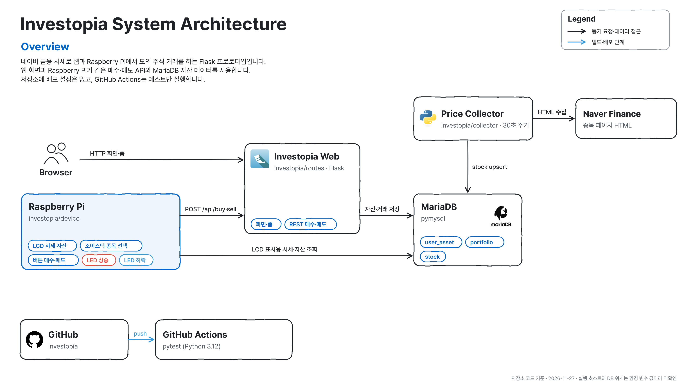
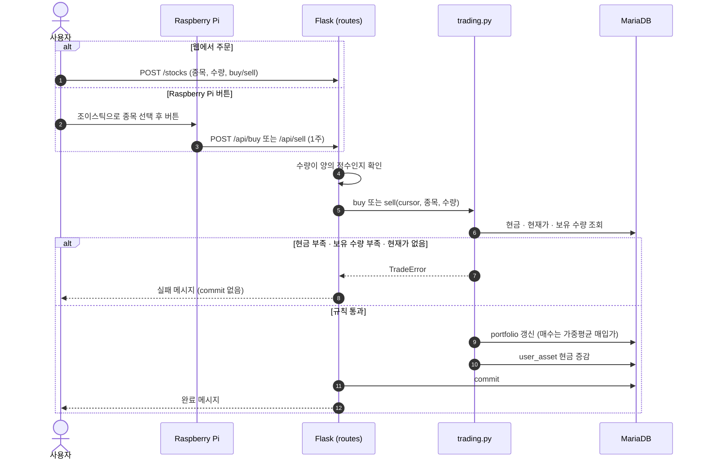
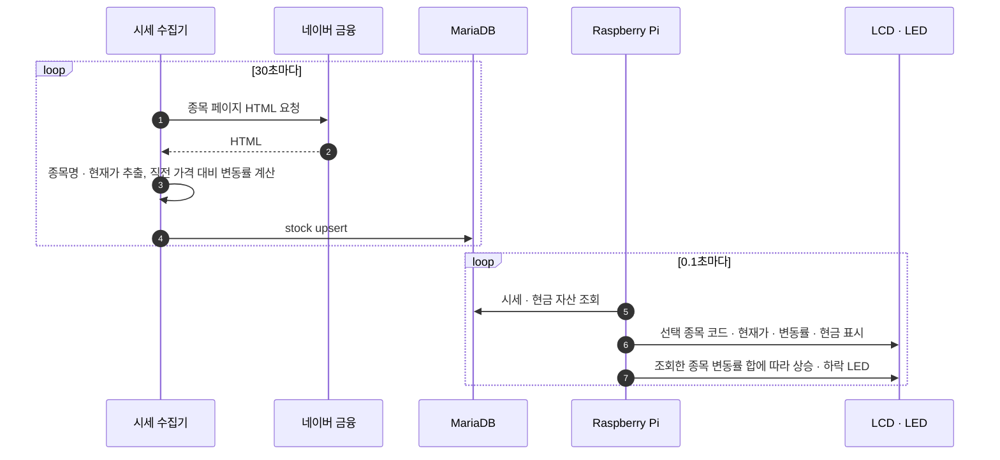
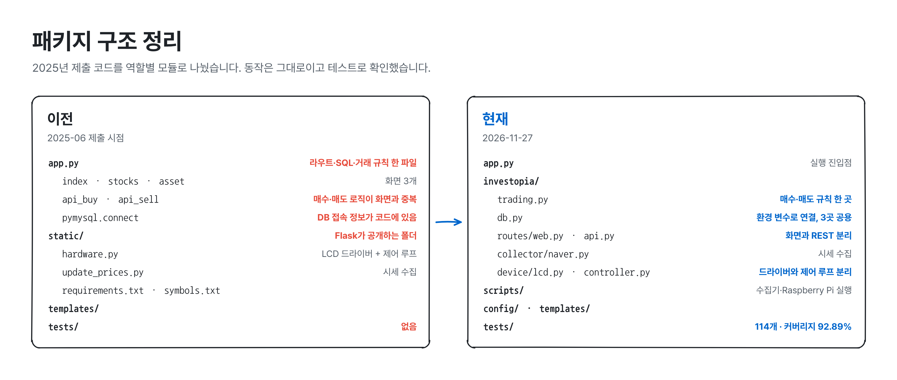

# INVESTOPIA

> 네이버 금융 시세로 웹과 Raspberry Pi에서 모의 주식 거래를 하는 Flask 프로젝트입니다.

| 항목 | 내용 |
| :-- | :-- |
| 기간·팀 | 2025.04.28–2025.06.17, 인덕대학교 3학년 B반 1조 5명 |
| 역할 | 허동현: 팀장, 기획·설계 총괄, 백엔드 개발 |
| 담당 | Flask 웹 서버와 MariaDB 연동, 매수·매도 API와 거래 규칙, Raspberry Pi가 같은 API를 쓰도록 연동, 설계·보고서 총괄 |
| 결과 | 웹 화면과 Raspberry Pi 버튼 주문이 같은 거래 규칙과 같은 자산 데이터를 사용. 이후 패키지 구조를 정리하고 테스트 114개로 동작 확인 |

<details>
<summary>팀원 역할</summary>

| 이름 | 담당 |
| --- | --- |
| 김지해 | 웹 UI 설계, PPT·회의록 |
| 김진석 | 회로 설계·구축·최적화, 센서 |
| 손민석 | 설계 시각화, 회의록·발표 대본 |
| 이준호 | 웹 UI, 회로 구축, PPT·Python 코드 |

</details>

## 전체 구조



시세 수집기가 네이버 금융 종목 페이지를 30초마다 읽어 MariaDB `stock` 표를 갱신합니다. 브라우저와 Raspberry Pi는 같은 Flask 서버의 매수·매도 규칙을 거쳐 `user_asset`, `portfolio` 표를 바꿉니다. 근거와 확인 범위는 [아키텍처 문서](./architecture/architecture.md)에 있습니다.

| 표 | 내용 |
| :-- | :-- |
| `user_asset` | 가상 현금 자산 |
| `portfolio` | 종목별 보유 수량과 평균 매입가 |
| `stock` | 종목명, 현재가, 직전 가격 대비 변동률 |

## 주문 처리 흐름



웹 폼과 REST API는 입력 형식만 다르고 같은 `trading.buy`, `trading.sell`을 호출합니다. 규칙을 어기면 commit하지 않고 연결을 닫아, 포트폴리오와 현금 중 한쪽만 바뀌는 일을 막습니다.

## 시세 수집과 Raspberry Pi 표시



현재가를 읽지 못한 종목은 건너뛰고 다음 종목을 수집합니다. LCD는 한글을 표시하지 못해 종목명 대신 종목 코드를 씁니다.

## 핵심 코드

### 1. 매수 규칙과 가중평균 매입가

[`investopia/trading.py`](./investopia/trading.py#L41-L84)

```python
total_cost = price * quantity
if asset < total_cost:
    raise TradeError(400, "insufficient asset", "자산이 부족합니다.")
...
if row:
    new_qty = old_qty + quantity
    avg_price = (old_qty * old_price + quantity * price) / new_qty
```

현금이 모자라면 DB를 바꾸기 전에 멈춥니다. 이미 가진 종목을 더 사면 기존 수량과 새 수량의 가중평균으로 매입가를 다시 계산합니다. `TradeError`는 API용 영문 메시지와 화면용 한글 메시지를 함께 가집니다.

### 2. 트랜잭션 경계는 라우트가 정함

[`investopia/routes/api.py`](./investopia/routes/api.py#L11-L40)

```python
conn = db.connect_dict()
cursor = conn.cursor()
try:
    try:
        trading.buy(cursor, symbol, quantity)
    except trading.TradeError as error:
        return jsonify({'result': 'fail', 'message': error.api_message}), error.status_code
    conn.commit()
finally:
    conn.close()
```

거래 규칙은 커서만 받고 commit하지 않습니다. 규칙을 모두 통과한 경우에만 라우트가 commit하고, 어느 경우든 연결을 닫습니다.

### 3. 시세 저장과 변동률

[`investopia/collector/naver.py`](./investopia/collector/naver.py#L93-L181)

직전에 저장한 가격을 먼저 읽고, 새 가격과 비교해 변동률을 계산한 뒤 `INSERT ... ON DUPLICATE KEY UPDATE`로 한 번에 저장합니다. 직전 가격이 없거나 0이면 변동률은 0으로 둡니다.

### 4. 버튼 입력을 주문 API로

[`investopia/device/controller.py`](./investopia/device/controller.py#L55-L130)

Raspberry Pi는 DB를 직접 바꾸지 않고 웹 서버의 `/api/buy`, `/api/sell`을 호출합니다. 그래서 버튼 주문도 웹 주문과 같은 거래 규칙을 거칩니다. GPIO·LCD·HTTP는 인자로 받아 테스트에서 가짜 객체로 바꿀 수 있습니다.

## 패키지 구조 정리



2025년 제출 코드는 라우트, SQL, 거래 규칙이 `app.py` 한 파일에 있었고 매수·매도 로직이 웹과 REST에 두 번 작성돼 있었습니다. 실행 스크립트는 Flask가 공개하는 `static/` 폴더에 있었습니다. 동작을 바꾸지 않고 역할별 모듈로 나눴고, 단계별 내용은 [패키지 구조 정리](./docs/refactoring/2026-11-package-structure.md)에 있습니다.

| 모듈 | 맡은 일 |
| :-- | :-- |
| `investopia/trading.py` | 매수·매도 규칙 |
| `investopia/routes/` | 화면(`web.py`)과 REST API(`api.py`) |
| `investopia/db.py` | MariaDB 연결 설정 (서버·수집기·Raspberry Pi 공용) |
| `investopia/collector/` | 네이버 금융 시세 수집 |
| `investopia/device/` | LCD 드라이버와 Raspberry Pi 제어 루프 |

## 화면

| 자산 요약 | 종목 목록과 거래 | Raspberry Pi |
| :-: | :-: | :-: |
|  |  |  |

<details>
<summary>시연 GIF와 나머지 화면</summary>

- [웹 UI 종목 매수](https://github.com/user-attachments/assets/c809936a-cac8-461f-a754-cf25659a9bb2)
- [LCD 종목·자산 정보 출력](https://github.com/user-attachments/assets/c0e714f6-5055-483a-ab2b-6965fad2dead)
- [버튼 매수](https://github.com/user-attachments/assets/afae5981-c73e-4c8b-a6fe-c3daad30461f)
- [버튼 매도](https://github.com/user-attachments/assets/cf3702aa-ab32-4b67-8c0b-758a0507263b)

<p align="center">
  
  
</p>
<p align="center">
  
  
</p>

</details>

## 한계

| 한계 | 내용 |
| :-- | :-- |
| LCD 한글 | 종목명 대신 종목 코드 표시 |
| 시세 | 30초 폴링이라 실시간 시세가 아니며, 네이버 금융 HTML 구조가 바뀌면 선택자를 고쳐야 함 |
| 사용자 | 현금 자산이 `id=1` 한 명뿐인 단일 사용자 구조 |
| 배포 | 저장소에 배포 설정이 없음 |

<details>
<summary>한계 화면</summary>

<p align="center">
  
  
</p>

</details>

## 테스트

```bash
pip install -r requirements.txt -r requirements-dev.txt
python -m pytest -q --cov=app --cov=investopia --cov-branch
```

114개 테스트, 라인+브랜치 커버리지 92.89% (2026-11-27). CI는 92% 미만이면 실패합니다. 테스트는 DB·네트워크·GPIO를 가짜 객체로 바꾸고, 외부 네트워크 접속을 막은 상태에서 실행합니다.

## 실행

`.env.example`을 복사해 환경 변수를 채웁니다. 비밀값이 들어간 `.env`는 커밋하지 않습니다.

```bash
cp .env.example .env
set -a; source .env; set +a
pip install -r requirements.txt

python scripts/update_prices.py   # 시세 수집기
python app.py                     # 웹 서버
```

Raspberry Pi에서는 GPIO 의존성을 더 설치하고 제어기를 실행합니다.

```bash
pip install -r requirements-rpi.txt
python scripts/hardware.py
```

## 기술 스택

| 영역 | 기술 |
| :-- | :-- |
| Server | Python, Flask, Jinja2 |
| Database | MariaDB, PyMySQL |
| Collector | Requests, BeautifulSoup |
| Hardware | Raspberry Pi, RPi.GPIO, 16×2 LCD, 조이스틱, 버튼, LED |
| Test | pytest, pytest-cov, GitHub Actions |

## 문서

* [아키텍처와 근거](./architecture/architecture.md)
* [패키지 구조 정리](./docs/refactoring/2026-11-package-structure.md)
