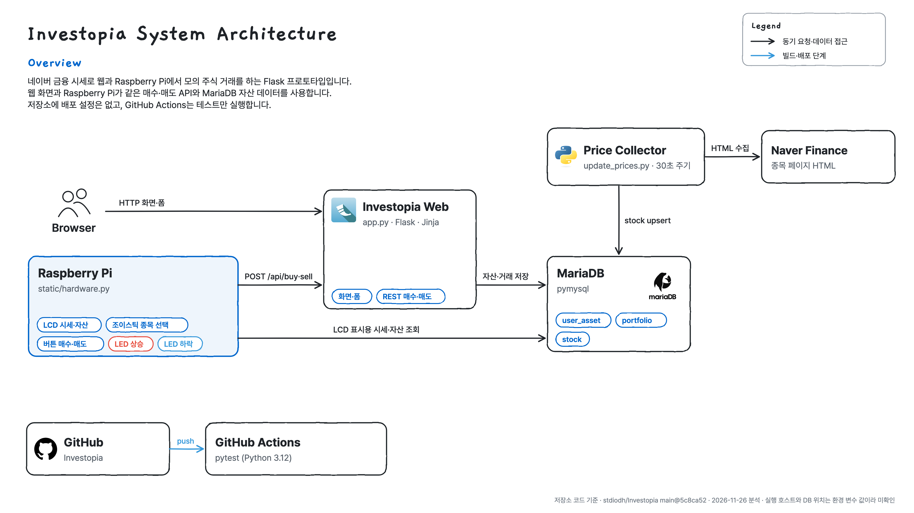

# Investopia System Architecture

[SVG 원본](./architecture.svg)

## 구조 요약

- 네이버 금융 종목 페이지에서 시세를 수집해 MariaDB에 저장하고, 웹과 Raspberry Pi에서 모의 매수·매도를 하는 Flask 프로토타입입니다.
- 웹 화면과 Raspberry Pi는 같은 `POST /api/buy`, `POST /api/sell` API로 주문하고, Raspberry Pi는 표시용 시세·자산을 MariaDB에서 직접 읽습니다.
- 시세 수집기는 별도 Python 스크립트로 30초 간격으로 돌며 `stock` 테이블에 upsert합니다.
- 저장소에 배포 설정은 없고, GitHub Actions는 pytest만 실행합니다.

## 조사 기준

| 항목 | 값 |
| --- | --- |
| 분석일 | 2026-11-26 |
| 저장소 | [stdiodh/Investopia](https://github.com/stdiodh/Investopia) |
| 확인한 커밋 | `main` [`5c8ca52`](https://github.com/stdiodh/Investopia/commit/5c8ca52063d31039948de919d47042d058211da0) |
| 대상 환경 | 코드 기준 논리 구조 (배포 설정 없음) |

## 근거표

`B` = `https://github.com/stdiodh/Investopia/blob/5c8ca52063d31039948de919d47042d058211da0`

| 도면의 구성요소·연결·경계 | 의미 | 근거 | 환경 | 확인 상태 |
| --- | --- | --- | --- | --- |
| Investopia Web | Flask 서버 렌더링 화면과 REST API | [app.py](https://github.com/stdiodh/Investopia/blob/5c8ca52063d31039948de919d47042d058211da0/app.py) (`/`, `/stocks`, `/asset`, `/api/buy`, `/api/sell`) | 공통 | 코드·설정 확인 |
| Web → MariaDB | `pymysql`로 자산·포트폴리오·시세 조회와 갱신 | [app.py](https://github.com/stdiodh/Investopia/blob/5c8ca52063d31039948de919d47042d058211da0/app.py) (`pymysql.connect`) | 공통 | 코드·설정 확인 (DB 호스트는 환경 변수) |
| Price Collector → Naver Finance | 종목 페이지 HTML 수집 | [static/update_prices.py](https://github.com/stdiodh/Investopia/blob/5c8ca52063d31039948de919d47042d058211da0/static/update_prices.py) (`NAVER_FINANCE_URL`) | 공통 | 코드·설정 확인 |
| Price Collector → MariaDB | `stock` upsert | [static/update_prices.py](https://github.com/stdiodh/Investopia/blob/5c8ca52063d31039948de919d47042d058211da0/static/update_prices.py) | 공통 | 코드·설정 확인 |
| Raspberry Pi → Web | 버튼 입력으로 매수·매도 API 호출 | [static/hardware.py](https://github.com/stdiodh/Investopia/blob/5c8ca52063d31039948de919d47042d058211da0/static/hardware.py) (`INVESTOPIA_SERVER_URL`) | 공통 | 코드·설정 확인 |
| Raspberry Pi → MariaDB | LCD 표시용 시세·자산 조회 | [static/hardware.py](https://github.com/stdiodh/Investopia/blob/5c8ca52063d31039948de919d47042d058211da0/static/hardware.py) (`pymysql.connect`) | 공통 | 코드·설정 확인 |
| GitHub Actions | pytest (Python 3.12) | [test.yml](https://github.com/stdiodh/Investopia/blob/5c8ca52063d31039948de919d47042d058211da0/.github/workflows/test.yml) | CI | 코드·설정 확인 |

## 로고 출처

| 기술·제품 | 사용 파일 | 공식 출처 페이지 | 실제 다운로드 URL·패키지 내 경로 | 확인일 | 원본 SHA-256 |
| --- | --- | --- | --- | --- | --- |
| Flask | `assets/logos/flask.svg` | https://palletsprojects.com/ | https://palletsprojects.com/static/content/projects/flask-logo.svg | 2026-11-26 | `8c6575b215bf0588eab1b41202ba626381bd2626da283547e17cf4c1c176251e` |
| Python | `assets/logos/python.svg` | https://www.python.org/community/logos/ | https://s3.dualstack.us-east-2.amazonaws.com/pythondotorg-assets/media/files/python-logo-only.svg | 2026-11-26 | `baec8662a1461c2cacc326b54d2727cb2f1ce07ba02d00f5b826d035104f649f` |
| MariaDB | `assets/logos/mariadb.svg` | https://mariadb.com/about-us/logos/ | https://mariadb.com/download/53702 (link 'Black vertical logo SVG (download)', served as mariaDBLogo_vertical_dark_transparent.svg) | 2026-11-26 | `b76b00a0af6056d521ed83c338d635895fa1be052dcf849d74d4fe2b2799d58b` |
| GitHub (also for GHCR) | `assets/logos/github.svg` | https://brand.github.com/foundations/logo | https://brand.github.com/GitHub_Logos.zip: GitHub Logos/SVG/GitHub_Invertocat_Black.svg | 2026-11-26 | `693d7abe6f899646cc2e96856723b45e95f71885a54910b2749f6decdf7e1ee1` |

## 확인 필요 사항

- 웹 서버, 수집기, MariaDB가 같은 호스트에서 도는지는 환경 변수 값이라 확인하지 못해 실행 경계를 그리지 않았습니다.
