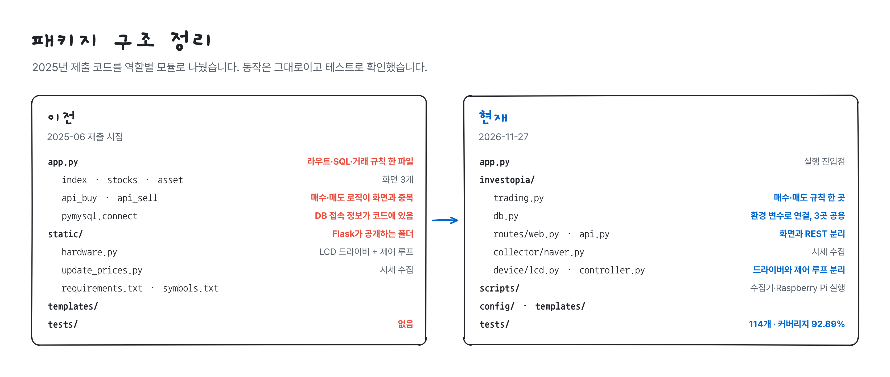

# 패키지 구조 정리

2025년 6월 제출한 코드는 `app.py` 한 파일과 `static/` 폴더의 스크립트로 이루어져 있었습니다. 세 번에 걸쳐 역할별 모듈로 나눴고, 단계마다 동작은 바꾸지 않았습니다.

## 이전 구조의 문제

| 문제 | 위치 | 영향 |
| --- | --- | --- |
| 라우트, SQL, 거래 규칙이 한 파일에 있음 | `app.py` (250줄) | 화면을 고치다 거래 규칙을 건드리기 쉬움 |
| 매수·매도 로직이 두 번 작성됨 | 웹 폼(`/stocks`)과 REST(`/api/buy`, `/api/sell`) | 한쪽만 고치면 웹과 Raspberry Pi의 결과가 달라질 수 있음 |
| DB 접속 정보가 코드에 있음 | `app.py`의 `get_connection` | 저장소에 접속 정보가 남음 |
| 실행 스크립트가 `static/`에 있음 | `static/hardware.py`, `static/update_prices.py` | Flask가 `/static/...`으로 공개하는 폴더라 소스가 노출될 수 있음 |
| DB 연결 코드가 세 곳에 따로 있음 | 웹 서버, 시세 수집기, Raspberry Pi 제어기 | 설정을 바꿀 때 세 곳을 함께 고쳐야 함 |
| LCD 드라이버와 제어 루프가 한 파일 | `hardware.py` (412줄) | 버튼 처리만 보려 해도 LCD 레지스터 코드를 함께 읽어야 함 |
| 테스트가 없음 | - | 구조를 바꿔도 동작이 같은지 확인할 수 없음 |

## 단계별 변경

| 날짜 | 변경 | 결과 |
| --- | --- | --- |
| 2026-07-30 | 접속 정보를 환경 변수로 옮기고 `.env.example` 추가, 실행 진입점을 `scripts/`로 분리 | 현재 코드에 비밀값이 없음 |
| 2026-07-30 | 매수·매도 규칙을 `_buy`, `_sell` 함수 하나로 모으고 테스트 110개와 CI 커버리지 게이트(92%) 추가 | 웹과 REST가 같은 규칙을 사용, 커버리지 92.14% |
| 2026-11-26 | 수집기·하드웨어 모듈을 `static/`에서 `workers/`로 이동 | Flask 공개 폴더에 소스가 없음, 테스트 112개 |
| 2026-11-27 | `app.py`를 `investopia/` 패키지로 나눔 (아래 표) | 테스트 114개, 커버리지 92.89% |

## 2026-11-27 변경 내용

| 이전 | 현재 | 맡은 일 |
| --- | --- | --- |
| `app.py`의 `TradeError`, `_buy`, `_sell`, 수량 검증 | `investopia/trading.py` | 매수·매도 규칙. 커서를 받아 쓰고, commit은 호출한 쪽이 결정 |
| `app.py`의 `/`, `/stocks`, `/asset` | `investopia/routes/web.py` | 화면과 폼 (Blueprint `web`) |
| `app.py`의 `/api/buy`, `/api/sell` | `investopia/routes/api.py` | Raspberry Pi가 호출하는 REST API (Blueprint `api`) |
| `app.py`, `hardware.py`, `update_prices.py`의 연결 함수 3개 | `investopia/db.py` | 환경 변수 읽기 한 곳. 수집기는 튜플 행, 나머지는 dict 행 |
| `workers/update_prices.py` | `investopia/collector/naver.py` | 네이버 금융 HTML 파싱, 변동률 계산, `stock` upsert |
| `workers/hardware.py`의 `LCD` 클래스 | `investopia/device/lcd.py` | HD44780 LCD 4비트 제어 |
| `workers/hardware.py`의 나머지 | `investopia/device/controller.py` | 조이스틱·버튼 입력, 주문 API 호출, LED 표시 |
| `app.py` 전체 | `app.py` | `create_app()`을 부르는 실행 진입점 |

`scripts/update_prices.py`, `scripts/hardware.py` 실행 방법은 그대로입니다. 템플릿의 `url_for`는 Blueprint 이름을 붙여 `web.stocks`처럼 바꿨습니다.

## 확인한 것

| 항목 | 이전 | 현재 |
| --- | --- | --- |
| pytest | 112 passed | 114 passed (`tests/test_db.py` 2개 추가) |
| 라인+브랜치 커버리지 | 92.14% | 92.89% |
| 라우트 | `/`, `/stocks`, `/asset`, `/api/buy`, `/api/sell` | 같음 |
| 실제 실행 | - | MariaDB 11 컨테이너에 표 3개를 만들고 웹 매수, REST 매수, 보유 수량 초과 매도 거절을 확인 |

테스트 파일 이름도 대상 모듈에 맞춰 `test_update_prices.py`는 `test_collector.py`로, `test_hardware.py`는 `test_device.py`로 바꿨습니다.
